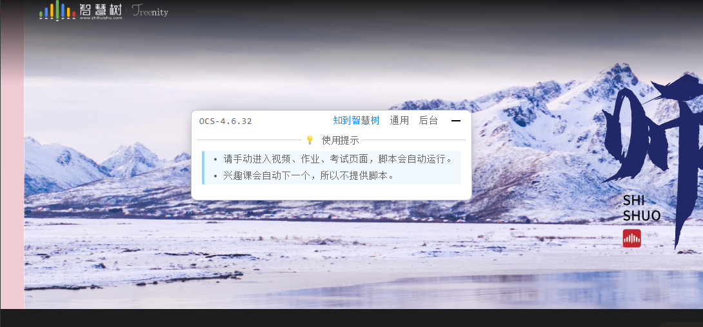

import { ScriptDownloadCards } from '../src/components/ScriptDownloadCards.tsx';  
import DocsVideo from '../src/components/DocsVideo.tsx';
import QuickInstall from '../src/components/QuickInstall.tsx';
import ScriptInstallAlert from './script.install.alert.mdx';
import Divider from '@mui/material/Divider';
import ScriptMetadata from './ScriptMetadata.mdx';
import OpenDevMode from './open.dev.mode.mdx';

<ScriptMetadata />
 

📱 手机&平板 等设备请查看此处教程：[https://docs.ocsjs.com/docs/mobile](/docs/mobile)
   

{/* 快捷更新/安装：默认隐藏，检测到 #quick-install 锚点时以弹窗显示 */}

<QuickInstall />
 

<Divider style={{margin: '12px 0px'}}>教程目录</Divider>

- [使用教程](#使用教程)
- [第一步 安装管理器](#first-step)
- [第二步 安装脚本](#install-script) 
- [第三步 开启自动答题](#open-answerer)
- [最后一步 学习如何更新/管理脚本](#update-and-manage) 

---

> 三步快速完成脚本安装

## 第一步 安装管理器  {#first-step}

视频教程如下，视频中脚本管理器 `ScriptCat` 链接 ：https://docs.scriptcat.org
 
<DocsVideo src="/videos/install_manage_guide.mp4" desc="视频教程"   className="docs-video-half"   />

 

## 第二步 安装脚本 {#install-script}
 
<DocsVideo src="/videos/install_script_guide.mp4"  desc="视频教程"  className="docs-video-half"  />

<Divider style={{margin: '12px 0px'}}>快捷安装&更新</Divider>

<ScriptDownloadCards />
 

安装完成后打开网课平台，等待页面上出现脚本窗口，根据面板提示操作，登录账号，进入视频学习，作业考试页面即可自动运行。

 
## 第三步 开启自动答题 {#open-answerer}

脚本默认带有视频，PPT翻页，等学习功能，如果想开启 **自动答题** 功能，请查看

自动答题教程 ： https://docs.ocsjs.com/docs/work

## 最后一步 学习如何更新/管理脚本 {#update-and-manage}

## 更新脚本教程 

链接：[https://docs.ocsjs.com/docs/update](/docs/update)

## 关闭脚本教程 

> 注意每个脚本管理器的页面是不一样的，但是关闭逻辑大致相同。

1. 打开右上角的脚本管理器，点击脚本管理。 

2. 然后进入脚本列表，找到左边开关按钮，点击即可关闭 

 

<DocsVideo src="/videos/close_script_guide.mp4"  desc="关闭脚本视频教程："    className="docs-video-half" />
 

 
## 删除脚本教程 

> 注意每个脚本管理器的页面是不一样的，但是删除逻辑大致相同。

1. 打开右上角的脚本管理器，点击脚本管理。
 
2. 然后进入脚本列表，找到右边删除按钮，点击即可删除

<DocsVideo src="/videos/remove_script_guide.mp4"    desc="删除脚本视频教程："   className="docs-video-half" />
 

---
教程结束